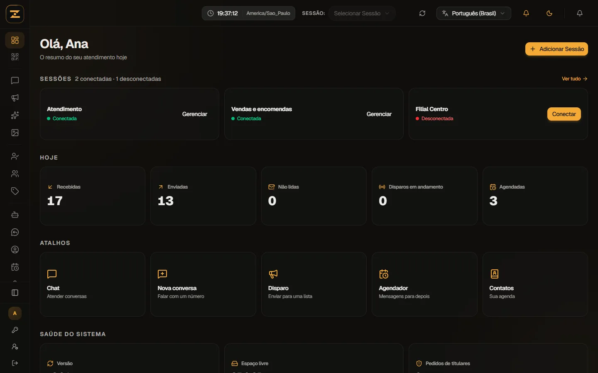
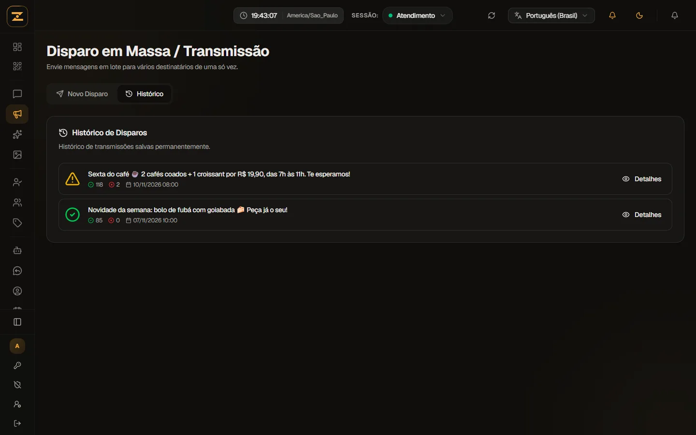
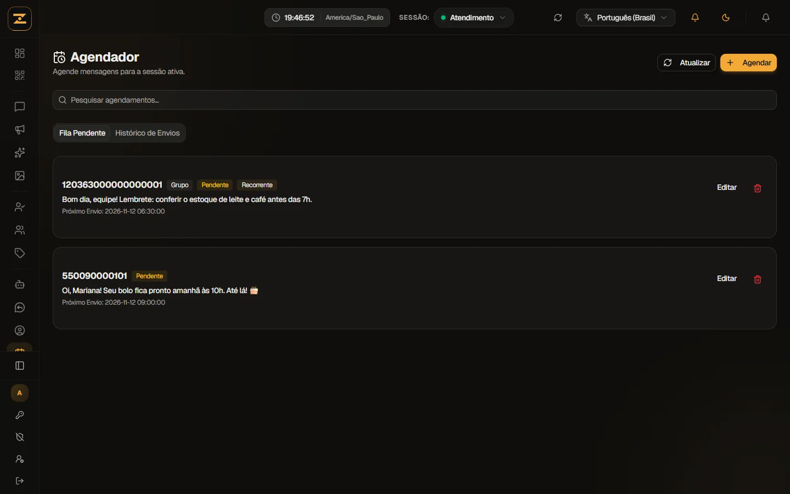
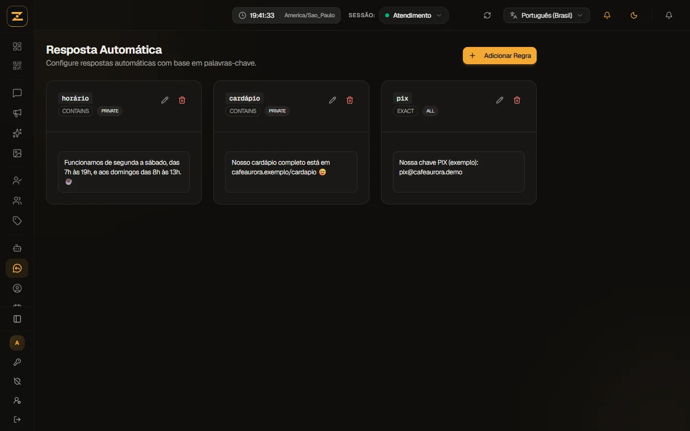

<p align="center">
  
</p>

<p align="center"><strong>Painel de atendimento por WhatsApp para equipes, instalado no seu servidor.</strong></p>

<p align="center">
  <a href="LICENSE"></a>
  <a href="CHANGELOG.md"></a>
  
  
</p>

<p align="center">
  
</p>

# ZapHub

O ZapHub conecta um ou mais números de WhatsApp a um painel web onde vários atendentes trabalham ao mesmo tempo: conversas em tempo real, disparos, respostas automáticas, agendamentos, webhooks e API. Ele não depende de nenhum serviço de terceiros para funcionar: o sistema, o banco de dados e os arquivos ficam no servidor de quem instala, e nenhum dado sai dali sem que o administrador configure (por exemplo, um webhook).

- Repositório: https://github.com/SanchesGi/ZapHub
- Licença: AGPL-3.0-only (veja [Licença](#licença))

> O ZapHub usa uma conexão **não oficial** com o WhatsApp. Leia o [aviso de responsabilidade](#aviso-de-responsabilidade) antes de usar.

## Telas

| | |
| :---: | :---: |
| <br>**Painel inicial:** sessões, números do dia e atalhos | <br>**Disparos:** campanhas com enviados, falhas e detalhes |
| <br>**Agendador:** mensagens únicas ou recorrentes | <br>**Respostas automáticas:** por palavra-chave |
| <br>**Página inicial** de cada instalação | <br>**Modo demonstração** para conhecer sem WhatsApp |

As imagens usam dados fictícios do modo demonstração (uma cafeteria inventada). Veja [docs/DEMO.md](docs/DEMO.md).

## O que ele faz

**Conversas**
- Chat em tempo real (Socket.IO) com lista de conversas, filtros de conversas e grupos e busca por nome ou número.
- Busca dentro da conversa, responder, reagir, encaminhar (inclusive contatos), apagar, fixar, silenciar, arquivar e marcar como lida ou não lida.
- Mensagem de voz gravada no navegador, com medidor de volume do microfone e trava contra áudio mudo; o servidor converte para o formato de voz do WhatsApp (OGG/Opus, com ffmpeg).
- Envio de fotos, vídeos e documentos; visualizador de imagens com zoom, giro e navegação entre fotos; player de vídeo e de áudio com velocidade.
- Prévia de links, corretor ortográfico em português que roda no navegador, menções em grupos e painel de informações do contato ou grupo (etiquetas, bloquear, salvar contato).

**Sessões e equipe**
- Várias sessões (números) por instalação, conectadas por QR Code ou código de pareamento.
- Compartilhamento de sessões entre usuários, com papéis Super Administrador, Supervisor e Equipe.

**Automação**
- Disparo em massa com intervalo entre mensagens e histórico de cada campanha.
- Mensagens interativas (botões de resposta rápida, link, ligação, copiar código e listas), com modelos prontos e compositor.
- Agendador: envio único ou recorrente (a cada X minutos ou horas, dias da semana ou expressão cron), com mídia opcional.
- Respostas automáticas por palavra-chave (exata, contém, começa com ou regex) e configurações do bot (comandos, modo de acesso, anti-spam, mensagem de boas-vindas, presença).
- Criador de figurinhas a partir de imagem ou vídeo.

**Organização**
- Contatos, grupos (lista e criação pelo painel; administração completa pela API) e etiquetas coloridas para organizar conversas.
- Gerenciador de mídia com filtros e exclusão em lote.

**Integração**
- Webhooks com assinatura HMAC-SHA256 (`X-Webhook-Signature`) e registro de entregas.
- API REST autenticada por chave (`X-API-Key`), com documentação em `/docs` e Swagger em `/swagger`.

**Segurança e administração**
- Usuários e papéis (`SUPERADMIN`, `STAFF`, `USER`), verificação em duas etapas (2FA/TOTP) para o Super Administrador.
- Auditoria de mensagens apagadas (o que era, quem apagou e por onde) e log de acesso (logins, falhas, 2FA, criação e remoção de usuários, troca de papel e senha).
- Manutenção pelo painel: atualizar o sistema, reiniciar o serviço, ver logs, ver o que ocupa o disco e limpar, mudar a pasta das mídias e mover os arquivos.
- Monitor do sistema (CPU, memória, disco) e notificações internas.

**Privacidade (LGPD)**
- Aceite versionado dos Termos de Uso e da Política de Privacidade no primeiro acesso.
- "Meus dados": cada usuário baixa os próprios dados e pode excluir a própria conta.
- Página de Privacidade para o Super Administrador: registro de pedidos de titulares, busca, exportação e exclusão dos dados de um contato.
- Retenção configurável de mensagens, mídias e logs, com limpeza automática diária às 03:00.

O painel está em português (padrão) e inglês.

## Como funciona

```
Navegador ──HTTPS──> servidor Node (Next.js + Socket.IO) ──Baileys──> WhatsApp
                              │
                              ├── MariaDB/MySQL (usuários, mensagens, contatos, credenciais do WhatsApp cifradas)
                              └── pasta de mídia em disco (fotos, áudios, vídeos, documentos)
```

- **Next.js 16 / React 19** para o painel e a API, servidos por um servidor próprio (`src/server/index.ts`) que também roda o **Socket.IO** para o tempo real.
- **Baileys 7** conversa com o WhatsApp como um "aparelho conectado".
- **Prisma 5** com **MariaDB** (ou MySQL) guarda tudo, inclusive as credenciais das sessões, cifradas com AES-256-GCM.
- As mídias ficam em disco (por padrão `data/media`; pode ser movida pelo painel, por exemplo para `/var/lib/zaphub/midia`).
- No Linux, roda como serviço do systemd (`zaphub.service`), com HTTPS próprio na porta 3443.

## Requisitos

- Servidor Linux (Ubuntu, Debian ou derivados do RHEL) com acesso de `sudo`.
- Node.js 22 (mínimo 20.9), MariaDB 10.6+ ou MySQL 8, git, openssl, ffmpeg, curl e util-linux.
- 2 a 3 GB de RAM, ou swap (a compilação consome memória; o instalador cria 2 GB de swap se faltar).
- Um celular com o WhatsApp de cada número que será conectado.

## Instalação rápida (Ubuntu/Debian)

```bash
sudo apt update && sudo apt install -y git curl openssl ffmpeg mariadb-server util-linux
curl -fsSL https://deb.nodesource.com/setup_22.x | sudo -E bash - && sudo apt install -y nodejs
git clone https://github.com/SanchesGi/ZapHub.git zaphub && cd zaphub
bash deploy/instalar.sh
```

O instalador pergunta o nome, o e-mail e a senha do **Super Administrador**, a conta com que você entra no painel. No fim, acesse `https://IP_DO_SERVIDOR:3443` e entre com ela. O guia completo, com banco, HTTPS, domínio, firewall, atualização, backup e problemas comuns, está em **[docs/INSTALACAO.md](docs/INSTALACAO.md)**.

## Documentação

| Documento | Conteúdo |
| :--- | :--- |
| [CHANGELOG.md](CHANGELOG.md) | O que mudou em cada versão |
| [docs/DEMO.md](docs/DEMO.md) | Modo demonstração: conhecer o painel com dados fictícios |
| [docs/INSTALACAO.md](docs/INSTALACAO.md) | Instalação do zero, HTTPS, atualização, backup e migração |
| [docs/CONFIGURACAO.md](docs/CONFIGURACAO.md) | Todas as variáveis do `.env` e o que se ajusta pelo painel |
| [docs/USO.md](docs/USO.md) | Guia do usuário do painel |
| [docs/LGPD.md](docs/LGPD.md) | Guia de LGPD para quem instala |
| [docs/SEGURANCA.md](docs/SEGURANCA.md) | Proteções aplicadas e o que fica com quem instala |
| [docs/API_DOCUMENTATION.md](docs/API_DOCUMENTATION.md) | Referência completa da API |
| [docs/API-QUICK-REFERENCE.md](docs/API-QUICK-REFERENCE.md) | Referência rápida da API |
| [docs/I18N.md](docs/I18N.md) | Traduções do painel |

## Atualizações

O ZapHub é mantido ativamente: correções, melhorias e revisões de segurança saem com frequência. Tudo o que muda em cada versão está em **[CHANGELOG.md](CHANGELOG.md)**. Para atualizar uma instalação: Manutenção > Sistema > Atualizar agora, no painel.

## Aviso de responsabilidade

- O ZapHub **não é um produto do WhatsApp nem da Meta** e não usa a API oficial (WhatsApp Business Platform). Ele se conecta por meio da biblioteca Baileys, como um aparelho conectado. O WhatsApp pode **restringir ou bloquear números** que usem esse tipo de conexão, principalmente em envios em massa ou para quem não pediu o contato. Use com moderação e por sua conta e risco.
- Respeite os Termos de Serviço e as políticas do WhatsApp e a legislação aplicável, em especial a **LGPD** (Lei 13.709/2018).
- **Quem instala é o controlador dos dados** tratados na instalação (mensagens, contatos, mídias, dados dos usuários). O autor do software não tem acesso à sua instalação nem aos seus dados. Veja [docs/LGPD.md](docs/LGPD.md).
- O software é fornecido "como está", sem garantias, nos termos da licença.

## Licença

O ZapHub é software livre sob a **GNU Affero General Public License v3.0** (AGPL-3.0-only). O texto que vale é o do arquivo [LICENSE](LICENSE). Em linguagem simples:

- você pode usar, estudar, modificar e redistribuir, inclusive em uso comercial;
- se distribuir uma cópia ou versão modificada, ela precisa continuar sob a AGPL-3.0, com o código-fonte;
- se oferecer uma versão **modificada** para outras pessoas usarem pela rede, precisa oferecer a elas o código-fonte dessa versão;
- os avisos de copyright e de licença precisam ser mantidos.

Os avisos de licença exigidos (inclusive um aviso MIT de parte do código inicial) estão em [CREDITOS.md](CREDITOS.md).

## Contribuição

Correções, melhorias, traduções e documentação são bem-vindas. Veja [.github/CONTRIBUTING.md](.github/CONTRIBUTING.md).

## Segurança

O ZapHub foi construído para guardar os dados de quem instala com cuidado. Em resumo:

- **Código verificado antes de cada versão:** tipos, testes (inclusive com banco real), build, `npm audit`, gitleaks (procura senhas e chaves) e SonarCloud. O servidor só instala versões aprovadas e volta sozinho se a nova não responder. O projeto passou por auditoria de segurança antes da publicação.
- **Acesso:** senhas com bcrypt, bloqueio de tentativas, 2FA (TOTP) para o administrador, papéis e permissão por sessão de WhatsApp, registro de acessos com IP.
- **Dados:** credenciais do WhatsApp cifradas (AES-256-GCM), mídias entregues só a quem tem acesso à conversa, limites de tamanho e de disco, auditoria de mensagens apagadas.
- **Rede:** HTTPS, Content-Security-Policy e cabeçalhos de segurança, proteção contra acesso a endereços internos (SSRF) nas mídias e prévias de link, webhooks assinados (HMAC-SHA256).
- **Servidor:** roda com usuário comum, permissões mínimas de administrador, nenhum comando vindo do navegador e **nenhuma telemetria**.
- **Privacidade:** recursos de LGPD (aceite de termos, exportação e exclusão de dados, pedidos de titulares, retenção).

Detalhes, com o arquivo de cada proteção e o que fica sob responsabilidade de quem instala: **[docs/SEGURANCA.md](docs/SEGURANCA.md)**.

Encontrou uma falha? **Não abra issue pública.** Siga [.github/SECURITY.md](.github/SECURITY.md).

## Contato

Ailan Sanches: ailansanches@tutamail.com

---

## English summary

ZapHub is a self-hosted WhatsApp customer-service panel for teams: multiple WhatsApp numbers, multiple agents, real-time chat, bulk sending, interactive messages, scheduler, auto-replies, webhooks and a REST API (API key, docs at `/docs` and `/swagger`), roles and 2FA, audit logs, in-panel maintenance and LGPD (Brazilian data protection law) tools. It runs on your own Linux server (Next.js 16, Socket.IO, Baileys 7, Prisma 5 with MariaDB/MySQL); no data leaves your server unless you configure it. It uses an **unofficial** WhatsApp connection (Baileys), so numbers may be restricted or banned by WhatsApp; you are responsible for complying with WhatsApp's terms and data protection laws. Install guide (Portuguese): [docs/INSTALACAO.md](docs/INSTALACAO.md). License: AGPL-3.0-only; see [CREDITOS.md](CREDITOS.md). Contact: ailansanches@tutamail.com.
